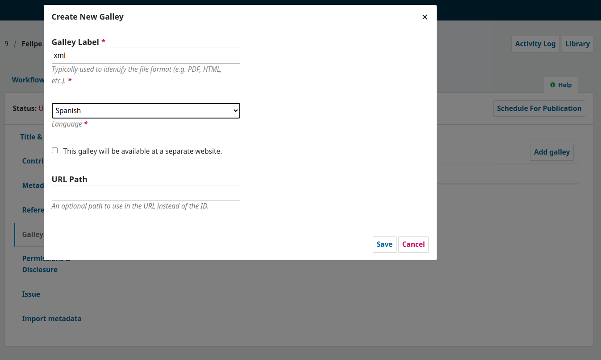
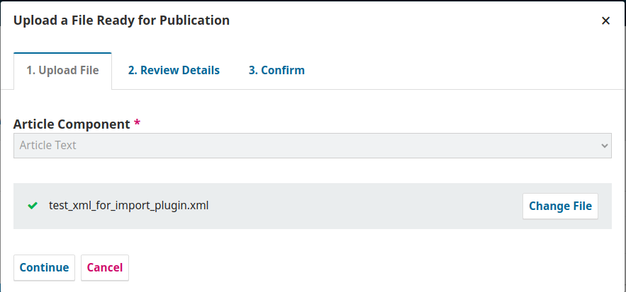
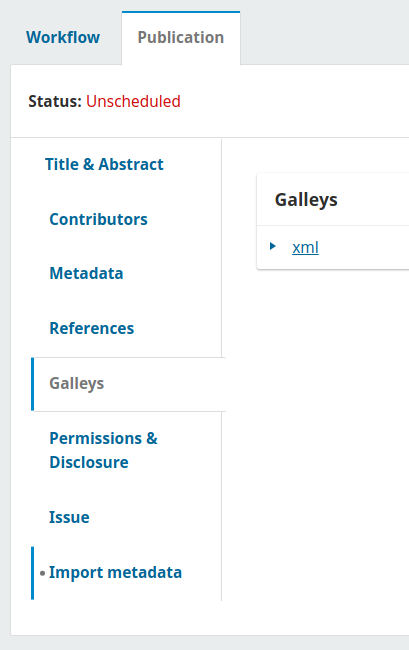

# Import metadata from XML

This plugin loads the publication metadata from a JATS XML galley.

| OJS | Branch | Release |
|---|---|---|
| 3.5 | `main`, `stable-3_5_0` | 1.2.0.1 |
| 3.4 | `stable-3_4_0` | 1.1.0.1 |
| 3.3 | `stable-3_3_0` | 1.0.0.1 |

## Instructions
### Plugin Installation Guide for OJS

You can install this plugin in two ways:

#### 1. Upload via the OJS Web Interface
- Download the `.tar.gz` file for your OJS version from the [Releases](https://github.com/Glaux-PA/importMetadataFromXML/releases) page.
- Go to **Settings** > **Website** > **Plugins**.
- Click on **Upload a New Plugin**.
- Select the `.tar.gz` file and upload it.
- Once installed, make sure to **enable** the plugin.

#### 2. Manual Installation
- Upload or extract the plugin folder into the appropriate directory:
  - ojs/plugins/generic
- Enable the plugin in **Settings** > **Website** > **Plugins**.

### Plugin Usage
* In the submission desired, add galley
    - 
* Upload xml for import metadata
    - 
* Apply "Import metadata"
    - 
* Review metadata added, title, description, contributors, references, etc...

## Improvements and Revisions
- [x] **Does not fetch author/contributor emails -> Feature**
  - Replaces it with the main contact -> sometimes
  - Depends on the XML file
    - The reported XML format is different from previously used ones
      - Consider the new format to save contributor emails -> **Feature** -> ✔️
- [x] **Keywords are not inserted in any language -> Feature**
  - Requires proper language configuration in the journal settings
  - Issues with multiple languages and the language set in the XML
  - Conflict with XMLs that include JEL codes -> **Feature** -> ✔️
  - Keywords in other languages are kept -> ✔️
- [x] **JEL Code -> A field specifically inserted for certain journals -> Feature**
  - Use it as keywords -> **Feature** -> ✔️
  - Insert it into the languages of the XML -> ✔️
  - JEL codes are imported even if the JEL group is not the last one -> ✔️
- [x] **Funding agencies -> Feature**
  - Only in one language -> Show the same in all the languages of the XML -> **Feature** -> ✔️
  - Does not capture the entire text
    - Extract the `funding-statement` tag -> **Feature** -> ✔️
- [x] **Abstract: Check if the text is formatted correctly (bold, etc.) -> Feature**
  - Currently discards title tags (summary) and includes only the content -> ✔️
  - Titles (if specified) should be included, except generic ones (summary) -> ✔️
  - Style (bold, italic) is important in both title and body -> ✔️
  - Links to references may occasionally appear, but they should not be incorporated -> ✔️
- [x] **Contributors: Inserts collaborators only in Spanish -> Feature**
  - Verify if the Role is fetched correctly -> ✔️
  - Affiliation: Verify -> ✔️
  - Author names keep their capitalization -> ✔️
  - Import works when no author has corresp="yes" -> ✔️
  - Authors are kept when the XML has no contrib-group -> ✔️
- [x] **References: Inserted in a seemingly incorrect format -> Feature**
  - A function is added to clean unwanted spaces in the text
- [x] **Add security to hide the button based on user role -> Feature**
  - Only allow Managers (and assigned Editors in OJS 3.5)
  - The role is also checked on the server -> ✔️
- [x] **Titles and subtitles: Manage secondary languages (trans-titles) or use defaults as is -> Feature**
- [x] **DOI: Now in a separate section and not being registered -> ✔️**
  - It is generating an incorrect DOI; it should fetch it from the XML.
  - The https://doi.org/ prefix is removed -> ✔️
- [x] **Refactor**
- [x] **Languages: Review language handling**
  - Use only the languages of the XML. The other languages are kept -> ✔️
  - xml:lang with region like es-ES is accepted -> ✔️
- [x] **Affiliations: Import affiliations outside the contrib element -> ✔️**
  - All affiliations of the author are imported -> ✔️
- [x] **Author group: Do not depend on the "AU" abbreviation in English -> ✔️**
  - Authors keep their user group after a new import -> ✔️
- [x] **Fields that are not in the XML are kept -> ✔️**
  - Author biography, email, ORCID, country, affiliation and URL are kept when the XML does not have them -> ✔️
  - Subtitle, pages, date, license, references and funding are kept when the XML does not have them -> ✔️
- [x] **Translations: Plugin name and description are translated -> ✔️**
  - Catalan and Portuguese translations -> ✔️
